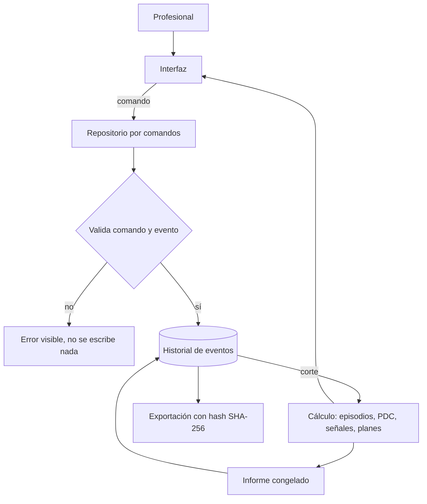

# Cómo funciona vihconectados (v0.4.0)

> Descripción del funcionamiento **tal y como está en el código** (cada paso cita su módulo). Es una demostración local con datos sintéticos: no hay servidor, cuentas ni validación clínica.

## 1. La idea en tres frases
1. **Todo lo que ocurre es un evento** que se añade al historial de un paciente; nada se borra ni se reescribe (solo se corrige con eventos nuevos).
2. **Todo lo que se ve se calcula** a partir de ese historial **hasta una fecha de corte** que elige el usuario.
3. El cálculo principal es la **cobertura de dispensación (PDC)** del TAR oral; de ella y de otros datos salen **señales** para que un profesional las revise. La herramienta **no decide nada**.

## 2. Esquema general
```
 PROFESIONAL (navegador)
        │  pulsa un botón / rellena un formulario
        ▼
 ┌──────────────────┐   formularios y vistas: app.js, vista-*.js, desktop.js,
 │   INTERFAZ        │   registro-manual.js, revision-datos.js, medicacion.js
 └────────┬─────────┘
          │ construye un COMANDO  (p. ej. «anexar_evento», «registrar_consulta»)
          ▼
 ┌──────────────────┐   repositorio.js → comandos.js
 │  REPOSITORIO      │   1) relee el almacenamiento  2) valida la forma del comando
 │  (por comandos)   │   3) lo aplica (función pura)  4) si todo va bien, guarda
 └────────┬─────────┘
          ▼
 ┌──────────────────┐   almacen.js (anexar) + esquemas-eventos.js
 │  VALIDACIÓN       │   tipo conocido · campos permitidos · obligatorios · tipos
 │  DEL EVENTO       │   + reglas de negocio (fechas, niveles, filas de dispensación…)
 └────────┬─────────┘
          ▼
 ┌──────────────────┐   localStorage  «vihconectados.demo.v1»   (formato demo@2)
 │  HISTORIAL        │   pacientes[ ].eventos[ ]  → solo se AÑADE
 │  DE EVENTOS       │   migraciones.js: lee demo@1 y guarda copia previa
 └────────┬─────────┘
          │  lectura  (+ fecha de corte elegida)
          ▼
 ┌──────────────────┐   temporal.js → motor.js → senales.js → consulta.js
 │  CÁLCULO          │   (dominio puro: sin navegador, mismas funciones en pruebas)
 └────────┬─────────┘
          ▼
   PANTALLAS · INFORMES (instantánea congelada) · EXPORTACIONES (con hash)
```



## 3. Los datos: 18 tipos de evento
Cada evento tiene un esquema cerrado (`src/esquemas-eventos.js`): un campo no previsto se rechaza.

| Grupo | Tipos de evento | Qué guarda |
|---|---|---|
| Tratamiento | `tratamiento` | Inicio de un **episodio** de TAR (oral o inyectable), con sus medicamentos de CIMA |
| Suministro | `importacion`, `correccion_dispensacion` | Dispensaciones (filas fecha/episodio/componente/días) y sus correcciones |
| Valoración | `nivel`, `visita`, `evaluacion_adherencia` | Nivel CMO manual, experiencia referida, valoración manual de adherencia |
| Plan y seguimiento | `consulta`, `seguimiento_consulta`, `actuacion`, `estado_actuacion` | Problema, objetivo, actuación, responsable funcional, revisión y resultado |
| Señales | `gestion_senal`, `revision_alertas` | Cómo se gestionó una señal; revisión profesional simulada |
| Comunicación | `informe`, `informe_paciente`, `estado_comunicacion` | Instantánea congelada y su circuito **simulado** |
| Solicitudes | `solicitud_valoracion`, `estado_solicitud` | Petición de valoración entre perfiles y su ciclo (enviada → recibida → respondida → cerrada) |
| Otros | `configuracion` | Sin uso en la aplicación actual |

Dos fechas por evento: **efectiva** (`fecha`: cuándo ocurre) y de **registro** (`registrado`: cuándo se guardó). La vista usa la efectiva (`temporal.js: fechaEfectiva`).

## 4. Algoritmo de escritura (guardar algo)
```
1. La interfaz construye un comando         p. ej. { tipo:"anexar_evento", paciente, evento }
2. repositorio.ejecutar(comando):
     a. lee de nuevo el almacenamiento       (evita pisar cambios de otra pestaña)
     b. validarComando(c): tipo conocido, campos permitidos, obligatorios
     c. aplicarComando(db, c) → copia nueva  (función pura, no toca el original)
          · anexar(): validarEvento (esquema) + reglas de negocio
          · asigna id y «registrado»
     d. SI algo falla en b o c → error, NO se escribe nada
     e. SI va bien → guarda la base completa
3. La interfaz se redibuja leyendo el historial
```
Una consulta guiada de 4 pasos solo guarda **al confirmar el último** (varios eventos de una vez, o ninguno).

## 5. Algoritmo de lectura (lo que se ve)
Entrada: **paciente, fecha de corte `fin`, reglas** (ventana 180 días, umbral 0,9: parámetros de demostración, sin validar).

```
A. eventos aplicables = los de fechaEfectiva ≤ fin                      (temporal.js)
B. episodios = eventos «tratamiento» en orden; cada uno termina donde empieza el siguiente
C. dispensaciones vigentes = filas de «importacion» − las anuladas o sustituidas por «correccion_dispensacion»
D. PDC (motor.js: cobertura):
     inicio = máx( fin − ventana , inicio del primer episodio )         intervalo [inicio, fin): el día de corte NO cuenta
     para cada episodio dentro del intervalo:
        · si es INYECTABLE → se EXCLUYE del cálculo (no hay PDC oral) y se anota
        · si es oral → para cada medicamento (componente):
              recorre sus dispensaciones por fecha; si una empieza antes de acabar la anterior,
              se encadena (el sobrante se arrastra DENTRO del episodio, nunca entre episodios);
              marca los días cubiertos
          día cubierto = lo están TODOS los componentes a la vez   (intersección; no se promedian %)
     PDC = días cubiertos / días evaluables         (null si no hay días evaluables)
E. señales (motor.js: alertas → senales.js: evaluarSenales):
     · TAR intramuscular presente            → «NO MONITORIZADO» (no se vigila la administración)
     · no hay intervalo evaluable            → «sin_datos»          (aviso metodológico)
     · PDC < umbral                          → «cobertura_demo»     (no acredita falta de toma)
     · dispensaciones fuera de su episodio   → «datos_fuera_episodio»
     · última visita con barrera/dificultad/efecto referido → «experiencia_referida»
   a cada señal se le añade: versión y estado de validación de su regla, una HUELLA de la evidencia
   y su gestión: si hay un «gestion_senal» con la MISMA huella → su estado; si no → «pendiente»;
   si antes se gestionó pero la evidencia cambió → «reabierta»
F. se pintan las pantallas; un informe guarda una INSTANTÁNEA de todo lo anterior
```
**Ejemplo (del manual):** dos medicamentos, 30 días; el A cubre los 30 y el B solo los primeros 20 → el TAR completo tiene 20/30 = **66,7 %** (no 83,3 %). Por debajo de 0,9 → señal «cobertura_demo». La herramienta **no concluye que el paciente no tome el tratamiento**.

## 6. Los tres «estados» que no hay que confundir
| Objeto | Estados | Qué significa cambiarlo |
|---|---|---|
| Señal | pendiente → revisada / justificada / actuación / cerrada (y «reabierta» si cambia la evidencia) | Documentar cómo se gestionó una evidencia calculada |
| Plan de consulta | en curso → cerrado, con resultado del objetivo | Documentar el seguimiento |
| Informe | pendiente → comunicado → recibido → valorado → resuelto | **Simulación**: no se envía nada |
| Solicitud de valoración | enviada → recibida → respondida → cerrada | Cada paso lo da el perfil que corresponde (destino: recibir y responder; origen: cerrar); sin avisos reales |
Ninguno actualiza a los demás automáticamente.

## 7. Qué hace y qué NO hace
| Hace | No hace |
|---|---|
| Calcula días de disponibilidad del TAR oral a partir de dispensaciones registradas | No mide toma real, ni carga viral, ni control virológico |
| Señala situaciones para revisión profesional | No decide, no recomienda cambios de TAR, no puntúa riesgo |
| Conserva la historia y permite corregirla sin borrar | No tiene usuarios, roles, auditoría protegida ni servidor |
| Registra TAR inyectable como «NO MONITORIZADO» | No calcula ventanas de inyección ni detecta administraciones perdidas |
| Exporta con huella SHA-256 (completo o mínimo) | La huella no es una firma |
| Funciona sin dependencias de ejecución ni IA | Ninguna regla está validada clínicamente |

## 8. Mapa de ficheros (lo mínimo para orientarse)
| Quiero entender… | Mira |
|---|---|
| Qué reglas hay y su estado | `src/reglas.js` · `docs/REGISTRO_REGLAS.md` |
| El cálculo del PDC y las alertas | `src/motor.js` (`cobertura`, `alertas`) |
| El corte temporal | `src/temporal.js` |
| La gestión de señales y la huella | `src/senales.js` |
| Cómo se guarda | `src/repositorio.js`, `src/comandos.js`, `src/almacen.js` |
| Qué forma tiene cada evento | `src/esquemas-eventos.js` · `docs/ESQUEMAS_EVENTOS.md` |
| La consulta guiada y los planes | `src/consulta.js`, `src/comandos-consulta.js`, `src/vista-consulta.js` |
| Informes y exportación | `src/informes.js`, `src/vista-informes.js`, `src/exportacion.js` |
| Qué está pendiente de decisión | `docs/strategy/DECISIONS_REGISTER.md` · `docs/strategy/RESUMEN_EJECUTIVO.md` |

## 9. Lo que existe solo como diseño (no se ejecuta)
Especificaciones con esquema y pruebas, **sin motor**: TAR de acción prolongada (`LA_TAR_CLINICAL_SPEC.md`), triangulación de fuentes (`EVIDENCE_TRIANGULATION_SPEC.md`, `src/esquema-evidencia.js`) y cuestionarios con escalado (`QUESTIONNAIRE_SPEC.md`, `src/esquema-cuestionario.js`). Mapeo a FHIR: `FHIR_MAPPING.md`. Nada de esto está conectado a la aplicación.
