# LA_TAR_CLINICAL_SPEC — Especificación clínica del TAR de acción prolongada (actuación A13)

| | |
|---|---|
| Estado | **BORRADOR TÉCNICO PARA REVISIÓN CLÍNICA. Nada de lo aquí propuesto está aprobado ni validado clínicamente** |
| Fecha | 2026-11-25 |
| Alcance | Cabotegravir + rilpivirina inyectables (Vocabria + Rekambys), pauta mensual y cada 2 meses, **solo para el seguimiento de las administraciones** |
| Lo que NO es | No es una guía de prescripción, no define elegibilidad ni dosis, y el sistema que describe no debe recomendarlas |
| Relación con otros documentos | `RISK_REGISTER.md` R01 · `TARGET_ARCHITECTURE_V2.md` §5.2 · `PRIORITIZED_BACKLOG.md` A13/B08 · `pruebas/corpus-dorado/la-tar.json` |

---

## 0. Estado frente a los criterios de aceptación de A13

| # | Criterio | Estado | Detalle |
|---|---|---|---|
| 1 | Fases, estados, ventanas y retrasos **con valores y referencia citada; ninguno inventado** | **Cumplido para los valores de la ficha técnica** (§3, todos con sección y cita). Todo lo que la ficha no fija queda como **decisión del comité** (§9), sin valor propuesto como definitivo | Las referencias se han leído de los textos oficiales, no de memoria (§2) |
| 2 | Reglas de señal, responsables y prioridades **aprobadas por el CCR** | **PENDIENTE.** §6 contiene una *propuesta* sin aprobar | Requiere el comité (`CLINICAL_GOVERNANCE.md`) |
| 3 | Lista de casos para el corpus dorado (A04) | **Cumplido**: 25 casos con resultado esperado en `pruebas/corpus-dorado/la-tar.json` (+3 casos pendientes de decisión) | Sin ejecutor: el módulo no existe (B08) |
| 4 | Revisión por **al menos dos clínicos** con experiencia en LA-TAR | **PENDIENTE.** Hoja de revisión en §11 | No puede hacerla el autor del borrador |

Hasta que se cumplan los criterios 2 y 4, este documento **no puede usarse como especificación aprobada** ni para implementar B08.

---

## 1. Alcance y exclusiones

**Dentro (seguimiento de administraciones):** registro de las inyecciones, cálculo de la fecha diana y de su ventana, detección de la inyección omitida según la ficha técnica, puente oral, cambio de pauta, interrupción y datos faltantes.

**Fuera, deliberadamente:**
- **Elegibilidad y selección de pacientes** (supresión virológica, ausencia de resistencias o fracaso previo con NNRTI/INI, peso, edad, etc., ficha técnica 4.1/4.2). El sistema no los evalúa.
- **Prescripción, dosis y pauta de reinicio.** El sistema muestra el tiempo transcurrido y la fila aplicable de la ficha técnica como **información**; no recomienda «reiniciar con dosis de carga». Esa frontera es una decisión de producto con consecuencias regulatorias (D-08; `REGULATORY_READINESS.md` §3: pasar de E2 a decidir el tratamiento eleva la clase).
- Interacciones, contraindicaciones, embarazo, lactancia, población pediátrica.
- **Otros fármacos de acción prolongada** (p. ej. lenacapavir subcutáneo) y cabotegravir inyectable para profilaxis preexposición: requieren su propia especificación (D-10). Hoy el catálogo solo admite la vía intramuscular (`src/cima.js`).

---

## 2. Fuentes y trazabilidad

| Fuente | Identificación | Cómo se leyó | Vigencia |
|---|---|---|---|
| Vocabria 400 mg / 600 mg, suspensión inyectable de liberación prolongada. Ficha técnica (Anexo I) | EMA, `vocabria-epar-product-information_en.pdf`, 114 páginas; metadatos de creación del PDF: 2026-10-12; «Date of latest renewal: 14 August 2025» | Descarga directa y extracción de texto del PDF completo, 2026-11-25 | **[VERIFICAR]** La sección «Fecha de revisión» está en blanco en el PDF |
| Rekambys 900 mg, suspensión inyectable de liberación prolongada. Ficha técnica (Anexo I) | EMA, `rekambys-epar-product-information_en.pdf`, 77 páginas; creación del PDF: 2025-06-25; «Date of latest renewal:» en blanco | Ídem | **[VERIFICAR]** |
| Fichas técnicas españolas de la AEMPS (CIMA) | VOCABRIA 600 mg, nº de registro 1201481003; REKAMBYS 900 mg, 1201482002 | Descarga del HTML oficial de CIMA, 2026-11-25; comprobación de las cifras clave | **[VERIFICAR]** fecha de la versión vigente |

**Contraste EMA/AEMPS.** Coinciden la ventana de ±7 días, el puente oral, los umbrales de las Tablas 4 y 5, los límites para iniciar un régimen alternativo y la persistencia farmacocinética. **Una diferencia de redacción** (Vocabria, Tabla 4, pauta mensual, más de 2 meses): el texto español de la AEMPS dice «reiniciar al paciente con la dosis de 600 mg, **y un mes después** continuar la pauta mensual de 400 mg»; el texto inglés de la EMA solo dice «re-initiate ... and then continue». La versión española es la autorizada en España; **los clínicos deben confirmar cuál rige**. El sistema no codifica la pauta de reinicio, así que no depende de ello, pero el texto que se muestre al profesional sí.

**No se ha consultado** ninguna guía clínica (GeSIDA, EACS, DHHS) para esta versión: la búsqueda no localizó el apartado concreto. Las referencias a guías quedan como `[REQUIERE REFERENCIA]` y las aporta el panel.

---

## 3. Parámetros procedentes de la ficha técnica

Citas breves de la ficha inglesa de la EMA (V = Vocabria, R = Rekambys); sección 4.2 salvo indicación.

| ID | Parámetro | Valor | Cita y ubicación | Corroborado en AEMPS |
|---|---|---|---|---|
| P-01 | Fase oral previa (opcional) | ≥ 28 días; cabotegravir 30 mg + rilpivirina 25 mg, 1 vez al día | V y R Tabla 1: «For one month (at least 28 days), followed by the Initiation Injection» | Sí |
| P-02 | Inicio, pauta mensual | 1 inyección de inicio (cabotegravir 600 mg + rilpivirina 900 mg) «on the final day of current antiretroviral therapy or oral lead-in» | V y R Tabla 2 | Sí |
| P-03 | Continuación, pauta mensual | Cabotegravir 400 mg + rilpivirina 600 mg, «one month after initiation injection and monthly onwards» | V y R Tabla 2 | Sí |
| P-04 | Inicio, pauta cada 2 meses | 2 inyecciones de inicio separadas 1 mes (600 mg + 900 mg) | V y R Tabla 3: «One month later, a second ... injection» | Sí |
| P-05 | Continuación, pauta cada 2 meses | Cabotegravir 600 mg + rilpivirina 900 mg, «Two months after last initiation injection and every 2 months onwards» | V y R Tabla 3 | Sí |
| P-06 | **Ventana de administración** | **Hasta 7 días antes o después** de la fecha programada: continuación mensual, segunda inyección de inicio y continuación cada 2 meses | V: «up to 7 days before or after the date of the monthly 400 mg injection schedule»; «... every 2 month, 600 mg injection schedule»; R análogo | Sí («hasta 7 días antes o después») |
| P-07 | Visita única, dos fármacos | Ambos «at separate gluteal injection sites at the same visit»; el orden no importa; los administra un profesional sanitario | V y R 4.2 | Sí |
| P-08 | **Inyección omitida** | Se considera cuando el paciente «plans to miss a scheduled injection visit by more than 7 days»; el paciente «should be clinically reassessed to ensure resumption of therapy remains appropriate» | V y R, «Missed doses» | Sí |
| P-09 | Puente oral, pauta mensual | Cabotegravir 30 mg + rilpivirina 25 mg diarios para sustituir «up to 2 consecutive monthly injection visits»; primera dosis oral «one month (+/- 7 days) after the last injection»; la inyección se reanuda «on the day oral dosing completes» | V y R, «Missed monthly injection» | Sí |
| P-10 | Puente oral, pauta cada 2 meses | Sustituye 1 visita de inyección; primera dosis oral «two months (+/- 7 days) after the last injection» | V y R, «Missed 2 month injection» | Sí |
| P-11 | Puente oral de más de 2 meses | V: «an alternative oral regimen is recommended». R (mensual): «an alternative oral regimen should be initiated one month (± 7 days) after the final injection»; R (cada 2 meses): ídem a los 2 meses (± 7 días) | V y R | Sí |
| P-12 | **Pauta mensual: tiempo desde la última inyección** | **≤ 2 meses:** continuar con la pauta mensual lo antes posible. **> 2 meses:** reiniciar con la dosis de inicio y continuar la pauta mensual | V Tabla 4; R Tabla 4 | Sí (con la diferencia de redacción de §2) |
| P-13 | **Pauta cada 2 meses: Inyección 2** | **≤ 2 meses:** reanudar lo antes posible y seguir cada 2 meses. **> 2 meses:** reiniciar con la dosis de inicio, **segunda inyección de inicio 1 mes después**, y seguir | V y R Tabla 5, fila «Injection 2» | Sí |
| P-14 | **Pauta cada 2 meses: Inyección 3 o posterior** | **≤ 3 meses:** reanudar. **> 3 meses:** reiniciar con las dos inyecciones de inicio | V y R Tabla 5, fila «Injection 3 or later» | Sí |
| P-15 | Cambio mensual → cada 2 meses | Una inyección (cabotegravir 600 mg / rilpivirina 900 mg) «one month after the last 400 mg continuation injection dose» y después cada 2 meses | V y R, «Dosing recommendations when switching» | Sí |
| P-16 | Cambio cada 2 meses → mensual | Una inyección (400 mg / 600 mg) «2 months after the last 600 mg continuation injection dose» y después mensual | V y R | Sí |
| P-17 | **Interrupción: régimen alternativo** | Pauta mensual: «no later than one month after the final injection». Pauta cada 2 meses: «no later than two months after the final injection» | V 4.2 y 4.4 «Risk of resistance following treatment discontinuation»; R 4.2 y 4.4 | Sí |
| P-18 | Persistencia farmacocinética | Cabotegravir: concentraciones residuales «up to 12 months or longer». Rilpivirina: «up to 4 years in some patients» | V 4.4 «Long acting properties»; R 4.4 «Long-acting properties» | Sí («hasta 12 meses o más»; «hasta 4 años en algunos pacientes») |
| P-19 | Contexto de riesgo (no se evalúa) | La ficha asocia mayor riesgo de fracaso virológico a una combinación de ≥ 2 factores basales: mutaciones de resistencia archivadas a rilpivirina, subtipo A6/A1 e IMC elevado; en esos pacientes, los datos disponibles sugieren más fracaso virológico con la pauta cada 2 meses que con la mensual | V 4.4 «Baseline factors associated with virological failure» (el signo de comparación del IMC se perdió en la extracción de texto; **verificar el umbral exacto en el PDF**) | Parcial |

**Contexto de adherencia que cita la propia ficha** (V y R 4.2): el prescriptor debe seleccionar a pacientes que acepten la pauta y asesorarlos sobre «the importance of adherence to scheduled dosing visits ... to reduce the risk of viral rebound and potential development of resistance with missed doses».

---

## 4. Modelo conceptual

### 4.1 Entidades y eventos (propuesta; patrón de `ESQUEMAS_EVENTOS.md`)

| Evento | Qué registra | Quién lo origina (hipótesis) | Estado |
|---|---|---|---|
| `inicio_la` | Inicio de una pauta de acción prolongada: régimen (mensual / cada 2 meses), fecha de la inyección de inicio, con o sin fase oral previa | Enfermería o Farmacia | No existe |
| `administracion_la` | Una administración: fecha, fármaco(s) administrados, tipo (inicio, continuación, reinicio), régimen, quién la administró | Enfermería (dato primario) | No existe |
| `cita_la` | Cita programada, asistida, no asistida o reprogramada | Agenda del centro | No existe |
| `dispensacion_la` | Entrega del vial o kit por Farmacia (no equivale a administración) | Farmacia | No existe |
| `puente_oral` | Inicio y fin del puente y fármacos orales | Farmacia / Infecciosas | No existe |
| `cambio_pauta_la` | De mensual a cada 2 meses o inversa | Infecciosas | No existe |
| `interrupcion_la` | Interrupción y régimen alternativo adoptado | Infecciosas | No existe |

Cada uno exige esquema cerrado (A08), actor y procedencia (B04) y ficha en el registro de reglas (A03). **Dispensación y administración son hechos distintos**: su discordancia es una señal de triangulación (A15).

### 4.2 Fases de una pauta

```mermaid
stateDiagram-v2
  [*] --> FaseOral: con fase oral previa (opcional, ≥28 días)
  [*] --> Inicio: directo a inyección
  FaseOral --> Inicio
  Inicio --> Continuacion: inyección(es) de inicio completadas
  Continuacion --> Continuacion: administración dentro de ventana ±7 d
  Continuacion --> Omitida: sin administración tras la ventana
  Omitida --> PuenteOral: puente oral previsto
  Omitida --> Reanudacion: reanudación (decisión clínica)
  PuenteOral --> Continuacion: reanuda al terminar el puente
  Omitida --> Reinicio: reinicio (decisión clínica)
  Reinicio --> Continuacion
  Continuacion --> CambioPauta: mensual ↔ cada 2 meses
  CambioPauta --> Continuacion
  Continuacion --> Interrumpida: interrupción
  Omitida --> Interrumpida
  Interrumpida --> ColaFarmacocinetica: persistencia (12 meses cabotegravir; hasta 4 años rilpivirina)
  Interrumpida --> [*]
```

Las transiciones a `Reanudacion` y `Reinicio` las **decide un profesional**; el sistema solo las registra.

---

## 5. Estados y cálculo

### 5.1 Diana, ventana y estado en una fecha de corte

Para la siguiente inyección debida, con fecha diana `T` y fecha de corte `D`:

- **Ventana** = `[T − 7 d, T + 7 d]`, extremos incluidos (P-06).
- `al_dia` si `D < T − 7`. `en_ventana` si `T − 7 ≤ D ≤ T + 7` y no hay administración registrada para esa diana. `retrasada` si `D > T + 7` y no hay administración registrada (P-08).
- `no_monitorizado` si no existen datos de administración (comportamiento actual de A06, que se mantiene hasta que haya datos).
- Estados adicionales: `puente_oral`, `interrumpida`, `cola_farmacocinetica` (informativo, P-18), `visita_incompleta` (D-05).

**Cálculo de la diana** (P-02…P-05, P-15, P-16): mensual, un mes tras la última inyección; cada 2 meses, un mes tras la primera inyección de inicio y dos meses después de la última; tras un cambio de pauta, según P-15/P-16. **Qué se toma como referencia tras una inyección dada dentro de la ventana pero no en la fecha diana lo decide el comité (D-01)**: la ficha no lo precisa. «n meses» se calcula como mes calendario, recortando al último día cuando no existe (D-02, propuesta).

### 5.2 Tiempo desde la última inyección (información, no recomendación)

Para una administración `retrasada`, el sistema calcula si `D` está **dentro o fuera** de `última inyección + k meses`, con `k = 2` (pauta mensual e Inyección 2 de la pauta cada 2 meses) o `k = 3` (Inyección 3 o posterior) (P-12…P-14). Muestra: «tiempo desde la última inyección: N días; la ficha técnica distingue ≤ k / > k meses (Tabla 4/5)» **y enlaza a la ficha**. No escribe «reiniciar» ni «reanudar» como indicación (D-08).

### 5.3 Puente oral e interrupción

- Primera dosis oral prevista: `última inyección + 1 mes ± 7 d` (mensual) o `+ 2 meses ± 7 d` (cada 2 meses) (P-09, P-10). Fuera de ese intervalo: aviso informativo.
- Duración del puente: más de 2 meses → «la ficha técnica recomienda un régimen oral alternativo» (P-11).
- Interrupción: si pasa `última inyección + 1 mes` (mensual) o `+ 2 meses` (cada 2 meses) sin régimen alternativo registrado → señal (P-17).

---

## 6. Señales propuestas (SIN APROBAR por el comité)

Los responsables y las prioridades son una **hipótesis de partida** a revisar por Farmacia, Infecciosas y Enfermería. «Prioridad» ordena por consecuencia clínica potencial; **no la fija ninguna fuente**.

| ID | Condición | Datos necesarios | Responsable (propuesta) | Prioridad (propuesta) |
|---|---|---|---|---|
| LA-S01 | La ventana de la próxima inyección se abre en N días (N: D-03) y no hay cita | `inicio_la`/`administracion_la`, `cita_la` | Enfermería / Farmacia | Baja |
| LA-S02 | En ventana sin cita ni administración registrada | Ídem | Enfermería | Media |
| LA-S03 | **Fuera de ventana sin administración** (omitida, P-08): mostrar tiempo desde la última inyección y fila de Tabla 4/5 | Ídem | Infecciosas + Farmacia | **Alta** |
| LA-S04 | Puente oral: primera dosis fuera de P-09/P-10; duración > 2 meses (P-11) | `puente_oral` | Infecciosas / Farmacia | Media |
| LA-S05 | Visita incompleta: solo uno de los dos fármacos registrado en una visita (P-07) | `administracion_la` por fármaco | Enfermería / Farmacia | Media (D-05) |
| LA-S06 | Discordancia: kit dispensado y sin administración registrada pasados X días | `dispensacion_la`, `administracion_la` | Farmacia | Media |
| LA-S07 | Interrupción sin régimen alternativo registrado dentro de P-17 | `interrupcion_la` | Infecciosas | **Alta** |
| LA-S08 | Cita no asistida | `cita_la` | Enfermería | Alta si coincide con LA-S02/S03 |
| LA-S09 | Sin datos de administración (`no_monitorizado`) | — | Farmacia | Según D-04 |

Toda señal pasa por el protocolo de respuesta (`CLINICAL_GOVERNANCE.md` §5), por el registro de reglas con estado «Pendiente de validación profesional» (A03) y por la gestión con motivo (`gestion_senal`).

---

## 7. Integración con lo ya construido

- **A06:** el estado `no_monitorizado` actual se conserva hasta que existan datos de administración; luego lo sustituye el cálculo de §5.
- **PDC oral y puente (D-06):** el puente oral puede modelarse con la cobertura oral existente (un episodio oral dentro de la pauta, con cabotegravir y rilpivirina como componentes), de modo que sus dispensaciones se evalúan con el motor y el corpus actuales. Es una opción; la alternativa es un evento propio sin PDC.
- **A03:** cada regla LA-S** tendrá ficha en el registro, con la fuente de §3 y estado pendiente.
- **A08:** cada evento de §4.1 necesita esquema cerrado y su muestra en la prueba.
- **A15:** `dispensacion_la` frente a `administracion_la` es el primer caso real de triangulación con fuentes distintas.

---

## 8. Corpus dorado

`pruebas/corpus-dorado/la-tar.json` contiene 25 casos con resultado esperado calculado a mano desde la ficha técnica y contrastado con una aritmética de calendario independiente (`pruebas/corpus-la-tar.test.mjs`, 5 pruebas superadas): ventana (límites incluidos y un día fuera), tiempo desde la última inyección en los límites de 2 y 3 meses, puente oral (inicio y duración), cambio de pauta e interrupción. Hay 3 casos más **sin resultado esperado** porque dependen de decisiones abiertas (D-01, D-02, D-11).

**Limitación:** hoy no hay módulo que ejecutar. Las pruebas comprueban la coherencia de los esperados, no un cálculo del sistema. No pueden afirmar que el futuro módulo sea correcto.

---

## 9. Decisiones abiertas para el comité

| ID | Decisión | Por qué no la fija la ficha técnica | Propuesta provisional (no aprobada) |
|---|---|---|---|
| D-01 | **Anclaje del calendario**: tras una inyección dentro de la ventana pero no en la diana, ¿la siguiente diana se calcula desde el calendario original o desde la fecha real? | La ficha dice «one month after ... and monthly onwards» sin precisarlo | Decidir con Infecciosas; hasta entonces no calcular la diana siguiente de forma automática |
| D-02 | Aritmética de «n meses» | La ficha no la define | Mes calendario, recortando al último día |
| D-03 | Antelación del aviso previo a la ventana (LA-S01) | Es un parámetro operativo del centro | Definir por centro |
| D-04 | Responsables y prioridades de cada señal | Decisión organizativa y clínica | §6 como punto de partida |
| D-05 | Visita incompleta (solo una de las dos inyecciones) | La ficha exige coadministración pero no define el estado | Señal informativa al profesional |
| D-06 | Puente oral: ¿PDC oral existente o evento propio? | Decisión de diseño | PDC oral existente |
| D-07 | Qué mostrar de la persistencia farmacocinética | La ficha da cifras generales, no un cálculo individual | Mensaje informativo, sin cálculo |
| D-08 | Qué muestra el sistema de las Tablas 4 y 5 | Mostrar la fila aplicable puede interpretarse como recomendación terapéutica (`REGULATORY_READINESS.md` §3) | Tiempo transcurrido + enlace a la ficha; sin texto de «reiniciar» |
| D-09 | ¿Registrar los factores basales (P-19) para priorizar? | La ficha los menciona como riesgo, no como regla de seguimiento | Fuera de la primera versión |
| D-10 | Otros fármacos de acción prolongada y PrEP | Fuera de las fichas leídas | Especificaciones separadas |
| D-11 | Inyección administrada más de 7 días **antes** de la diana | La ficha no la contempla | Señal informativa |
| D-12 | Referencia de la diana tras reinicio o puente oral | La ficha da la reanudación, no el calendario posterior | Reanclar en la inyección de reanudación |

---

## 10. Preguntas clínicas para el panel

1. ¿La pauta de seguimiento de su centro usa la fecha diana de calendario o la de la última inyección? ¿Cómo gestionan hoy una inyección dada a los 5 o 6 días?
2. ¿Quién registra la administración (Enfermería, Farmacia) y dónde? ¿Existe hoy una agenda de citas accesible?
3. ¿Se dispensa el kit de forma individualizada para cada visita? ¿Cuánto tiempo suele pasar entre dispensación y administración?
4. ¿Qué plazo consideran clínicamente relevante para avisar de una inyección omitida (la ficha usa más de 7 días)?
5. ¿Quién decide la reanudación o el reinicio y con qué información?
6. ¿Qué experiencia tienen con puentes orales y con interrupciones?
7. ¿Qué datos de la ficha de §3 no coinciden con su práctica o con la versión vigente?

---

## 11. Plan de revisión y hoja de aprobación

**Revisión requerida:** al menos dos clínicos con experiencia en terapia inyectable de acción prolongada, uno de Infecciosas y uno de Farmacia Hospitalaria; Enfermería para §4.1 y §6. Los autores del borrador no pueden ser los revisores.

**Procedimiento:** (1) confirmar la vigencia de las fichas de §2 en CIMA; (2) comprobar uno a uno los valores de §3 contra la ficha; (3) resolver D-01…D-12 por escrito; (4) aprobar o modificar §6; (5) revisar los 25 casos del corpus; (6) registrar discrepancias sin editar el corpus hasta que el comité decida.

| Revisor | Función | Fecha | Valores de §3 conformes (Sí/No) | Decisiones D-xx resueltas | Observaciones | Firma |
|---|---|---|---|---|---|---|
| `[DATO PENDIENTE]` | | | | | | |
| `[DATO PENDIENTE]` | | | | | | |

Aprobación del comité clínico: `[DATO PENDIENTE]` · Acta: `[DATO PENDIENTE]`.

---

## 12. Riesgos y límites de esta especificación

- **Error de transcripción:** los valores proceden de la extracción automática de texto de PDF y HTML; lo mitigan el contraste EMA/AEMPS y la revisión clínica obligatoria, no la confianza en el borrador.
- **Vigencia:** las fichas se actualizan; el registro de reglas (A03) debe versionar la ficha técnica de origen.
- **Falsa seguridad:** que una administración esté «en ventana» no demuestra control virológico; el sistema sigue sin ver carga viral ni resistencias.
- **Frontera regulatoria:** mostrar tiempo transcurrido y la ficha es información; recomendar la pauta de reinicio acerca el sistema a la decisión terapéutica (D-08).
- **Alcance:** solo cabotegravir + rilpivirina; no extrapolar a otros fármacos.
- **No hay evidencia en este documento** de que las señales mejoren resultados: es una hipótesis que evalúa `VALIDATION_MASTER_PLAN.md`.
