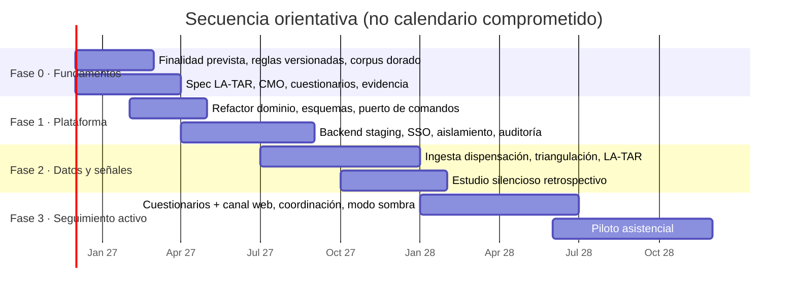

# PRODUCT_ROADMAP — Hoja de ruta de VIHconectados 2.0

| | |
|---|---|
| Estado | **PROPUESTA PARA REVISIÓN** · 2026-11-25 |
| Naturaleza | Secuencia por **dependencias y puertas de decisión**, no calendario comprometido |
| Duraciones | **Orden de magnitud** `[DATO PENDIENTE: tamaño del equipo, financiación y apoyo institucional]`. Si no hay equipo dedicado, multiplicar sustancialmente |

---

## 1. Principios de secuenciación

1. **Seguridad y evidencia antes que funcionalidad** (R01, R03, R27 son los riesgos de mayor peso).
2. **Lo que no requiere infraestructura ni coste se hace primero** y desbloquea lo demás (clase A del backlog).
3. **Ningún dato real sin puerta G1** (`VALIDATION_MASTER_PLAN.md` §9).
4. **El canal con el paciente va al final de la cadena de dependencias**: necesita backend, consentimiento, EIPD y reglas validadas.
5. **No se elimina funcionalidad**: la demo sigue funcionando en modo sin servidor.

---

## 2. Visión por fases

> El diagrama es **ilustrativo**. Las barras dependen de recursos y de que se superen las puertas; pueden desplazarse o cancelarse.

---

## 3. Fases en detalle

### Fase 0 — Fundamentos y diseño (sin infraestructura, sin coste)
**Objetivo:** cerrar las decisiones que condicionan todo lo demás y eliminar el riesgo crítico R01 a nivel de presentación.
**Contenido (ver `PRIORITIZED_BACKLOG.md`):** A01 finalidad prevista · A03 registro de reglas · A04 corpus dorado · A06 higiene clínica de código · A02 trazabilidad · A11 licencia y atribuciones · A13 especificación LA-TAR · A16 CMO por dimensiones (si el equipo aporta rejilla) · A17 rol Enfermería · A21 política N3 y texto libre.
**Resultados esperables:** documentos aprobados; sin cambios de comportamiento clínico salvo A06 (visibilidad).
**Salida (G0):** finalidad prevista aprobada; ruta regulatoria elegida; riesgos recalibrados; CCR constituido.

### Fase 1 — Plataforma institucional mínima (infraestructura del centro)
**Objetivo:** que el sistema pueda *albergar* datos reales de forma segura, sin usarlos todavía.
**Contenido:** A07, A08 (refactor y esquemas) · B01 (backend de comandos) · B02 (identidad/RBAC) · B03 (aislamiento) · B04 (auditoría) · B05 (persistencia y recuperación) · B07 (entornos) · A10 (modelo de amenazas) · C03 (EIPD) · C06 (revisión de seguridad).
**Requiere:** sponsor institucional, entorno de TI, DPD.
**Salida (G1):** entorno staging con datos sintéticos, pruebas de aislamiento superadas, EIPD aprobada.

### Fase 2 — Datos, evidencia y LA-TAR
**Objetivo:** primeras fuentes reales y el diferencial técnico (triangulación + LA-TAR).
**Contenido:** B06 (ingesta de dispensaciones) · B10 (laboratorio) · A12/B15 (FHIR) · A15/B09 (evidencia y triangulación) · B08 (módulo LA-TAR) · A20 (validación fase 1: estudio silencioso retrospectivo, con CEIm).
**Salida (G2):** informe de validez de contenido y de calidad de datos; decisión sobre modo sombra.

### Fase 3 — Seguimiento activo y coordinación
**Objetivo:** contacto entre consultas con garantías.
**Contenido:** A14/B12 (cuestionarios + canal web autenticado) · B11 (tareas, acuses, Enfermería) · B13 (SMS/voz institucional, opcional) · C08 (consentimiento) · C07 (usabilidad) · Fases 2 y 3 de validación.
**Salida (G3):** piloto asistencial aprobado; protocolo de respuesta a señales vigente.

### Fase 4 — Escalado y sostenibilidad
**Objetivo:** extensión a otros centros y vigilancia continua.
**Contenido:** decisión de ruta regulatoria cerrada (C01/C02), gestión multicéntrica, publicación de resultados, mantenimiento del registro de reglas, B14 (observabilidad).
**Salida (G4):** despliegue ampliado.

---

## 4. Qué se puede hacer **ya** (sin comprometer seguridad ni coste)

| Actuación | Por qué es seguro/gratuito | Dependencia |
|---|---|---|
| A01 Finalidad prevista y decisión de ruta | Es un documento; reduce riesgo | Ninguna |
| A02 Matriz de trazabilidad y corrección de deriva documental | Es documentación | Ninguna |
| A03 Registro de reglas versionado (sin cambiar valores) | Refactor de datos, comportamiento idéntico | Ninguna |
| A04 Corpus dorado | Casos sintéticos; solo añade pruebas | Un segundo revisor |
| A05 CI | Sin coste (si el plan de GitHub lo permite) | Visibilidad del repositorio |
| A06 Higiene clínica de código (nivel por defecto, estado «no monitorizado») | Cambio acotado con pruebas | Ninguna |
| A08 Esquemas cerrados | Mejora de integridad; añade pruebas | Ninguna |
| A09 Manifiesto y minimización de exportaciones | Cambio acotado | Ninguna |
| A10 Modelo de amenazas | Documento | Ninguna |
| A11 Licencia y atribuciones | Decisión del autor | Asesoría legal ligera |
| A12 Mapeo FHIR | Documento + validación con herramienta abierta | Ninguna |
| A13–A17, A19–A21 | Especificaciones y políticas | Participación clínica |

## 5. Qué necesita infraestructura institucional

Todo B01–B15, y las Fases 1–3. Sin sponsor y entorno de TI no hay camino hacia datos reales; esta es **la dependencia crítica de gestión** del proyecto.

## 6. Qué necesita asesoramiento regulatorio/jurídico especializado

C01–C08. La decisión C02 (ruta CE / in-house / investigación) condiciona el modelo de distribución multicéntrica y no debe posponerse a la Fase 3.

---

## 7. Hitos de decisión para la dirección del proyecto

| Hito | Pregunta | Quién |
|---|---|---|
| H0 | ¿Aprobamos este conjunto de documentos como base? | Autor + equipo |
| H1 | ¿Qué finalidad prevista (E1/E2/E3)? | CCR + asesor |
| H2 | ¿Qué centro piloto y qué sponsor? | Dirección |
| H3 | ¿Se constituye el CCR y quién es el revisor independiente? | Dirección |
| H4 | ¿Ruta CE, in-house o investigación? | Dirección + asesor |
| H5 | ¿Instrumentos PROM/PREM y licencias? | CCR |

---

## 8. Riesgos de la hoja de ruta

| Riesgo | Mitigación |
|---|---|
| Subestimar esfuerzo de backend y seguridad | No iniciar B-grupo sin sponsor y personal de TI |
| Presión por mostrar «voz/IA» | Mantener el canal como adaptador y exigir puertas |
| Dependencia de una persona | Documentación, CI, revisión independiente |
| Cambios regulatorios | Revisión semestral con asesor |
| Calidad de datos del centro | Medir antes de comprometer validación |

---

## 9. Indicadores de progreso del propio proyecto

| Indicador | Meta cualitativa |
|---|---|
| % de reglas N1 con ficha y estado de validación | 100 % antes de G1 |
| Tipos de evento con esquema cerrado | 100 % antes de B01 |
| Riesgos críticos (R01) con control implantado y verificado | Antes de G1 |
| Documentos regulatorios aprobados | Según §H1–H4 |
| Pruebas de aislamiento automatizadas en CI | Antes de G1 |
