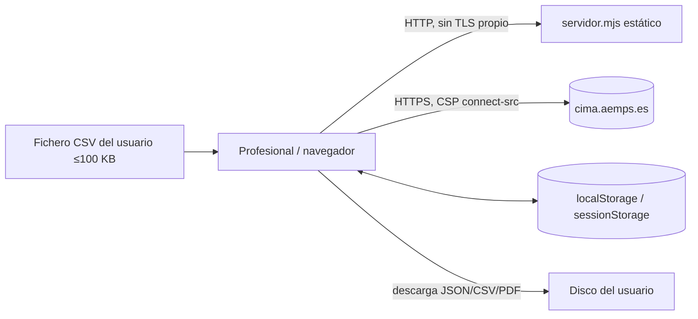

# THREAT_MODEL — Modelo de amenazas y plan de pruebas de seguridad (actuación A10)

| | |
|---|---|
| Estado | **BORRADOR SIN REVISAR por una persona de seguridad** (criterio 3 de A10 pendiente, D-G17). No es una evaluación de seguridad ni una prueba de penetración |
| Fecha | 2026-11-26 |
| Método | STRIDE sobre los elementos del diagrama de §2. Lo comprobado se distingue de lo inferido |
| Alcance | **Parte A:** la aplicación tal y como existe hoy (demostración en el navegador, datos sintéticos). **Parte B:** amenazas **previstas** para un futuro servidor, sin código que evaluar |
| Qué NO se afirma | Que la aplicación sea «segura»: solo que ciertas propiedades concretas se comprueban hoy y que las demás están abiertas o fuera de alcance |

> **Premisa de la demo:** el navegador y el usuario son el mismo actor de confianza (`PILOTO.md`: no hay cuentas ni servidor de pacientes). Muchas «amenazas» de la Parte A solo importan **si alguien introdujera datos reales**, lo que la documentación prohíbe. Por eso la gravedad se razona para un E0 (demo) y para un E1+ (uso institucional) por separado.

---

## 1. Activos

| ID | Activo | Dónde está hoy | Por qué importa |
|---|---|---|---|
| AS-1 | Historial de eventos del paciente (sintético hoy; real en E1+) | `localStorage` clave `vihconectados.demo.v1` (`src/almacen.js`, `src/repositorio.js`) | Confidencialidad (RGPD, categoría especial) e integridad clínica |
| AS-2 | Reglas y parámetros (ventana, umbral, versión) | `src/reglas.js`; parámetros de sesión en `sessionStorage` | Una regla alterada cambia qué señales ve el profesional (R03) |
| AS-3 | Informes congelados y exportaciones | Eventos `informe` y ficheros descargados (`src/informes.js`, `src/exportacion.js`) | Salen del sistema y de su control (R19) |
| AS-4 | Catálogo CIMA (medicamentos) | Respuesta de `cima.aemps.es` (`src/cima.js`) | Un dato erróneo condiciona el TAR registrado (R25, R26) |
| AS-5 | Disponibilidad y código servido | `servidor.mjs`, `index.html`, `src/*.js` | Confianza en lo que ejecuta el navegador |
| AS-6 | (Futuro) credenciales, sesiones, auditoría, copias | No existen | Parte B |

## 2. Límites de confianza

| Límite | Qué cruza | Control comprobado |
|---|---|---|
| L1 servidor → navegador | código y `datos/*.json` | Lista blanca de rutas, CSP, `nosniff`, `no-store` (`pruebas/seguridad-superficie.test.mjs`) |
| L2 navegador → CIMA | consultas y respuesta JSON | `connect-src` limitado; `credentials: "omit"`; `referrerPolicy: "no-referrer"`; tiempo máximo 15 s; texto truncado a 500 caracteres; enlaces validados por `urlAemps` |
| L3 usuario → aplicación | CSV importado, texto libre | Tamaño ≤ 100 KB; esquemas cerrados de evento (A08); escape al pintar |
| L4 aplicación → disco | exportaciones | Manifiesto con hash (A09); **sin** firma ni cifrado |
| L5 aplicación → almacenamiento | base completa en claro | Ninguno de confidencialidad (por diseño de demo) |

## 3. Amenazas de la Parte A (aplicación actual)

**Estado:** `Comprobada` = hay una prueba o sondeo que lo verifica · `Inspección` = visto en el código, sin prueba · `Abierta` = no mitigada · `Aceptada (demo)` = aceptable solo en E0, **no** en E1+.

| ID | STRIDE | Amenaza | Evidencia y control actual | Estado | Riesgo / actuación |
|---|---|---|---|---|---|
| T-01 | I, E | Lectura de ficheros del servidor fuera de la lista blanca (recorrido de ruta, `servidor.mjs`, `.git`, pruebas, Markdown) | Regex de ruta cerrada. Sondeo y pruebas: 10 rutas hostiles devuelven 404 | **Comprobada** | R24 |
| T-02 | T, E | XSS por contenido externo (CIMA) o texto libre (`objetivo`, `observaciones`, `instrucciones`, nombre del medicamento) | CSP `script-src 'self'` sin `unsafe-inline`/`unsafe-eval`; `esc()`/`escapar()`; pruebas de escape con `<script>` e `` (`desktop.test.mjs`, `cima-informes.test.mjs`). Hay **25 asignaciones a `innerHTML`**; no se ha auditado línea a línea cada interpolación. Una búsqueda dirigida de campos de texto libre sin escape solo halló usos con `textContent` o texto plano | Comprobada parcialmente | R24 · **Pendiente:** auditoría completa de las 25 asignaciones |
| T-03 | E | Ejecución dinámica de código (`eval`, `new Function`, `document.write`, `insertAdjacentHTML`) | Ninguna aparición; prueba que falla si se añade | **Comprobada** | R24 |
| T-04 | T | Inyección de contenido por un ataque a CIMA o a la red (respuesta manipulada) | TLS del navegador hacia `cima.aemps.es`; campos truncados y escapados. **Sin comprobación de integridad del catálogo** más allá de TLS | Inspección | R25, R26 |
| T-05 | I | Exfiltración de `localStorage` por un script inyectado | `connect-src 'self' https://cima.aemps.es`: un script inyectado no puede enviar a un host arbitrario. Residual: podría codificar datos en una consulta a CIMA (sin acceso del atacante a esos registros): riesgo despreciable, anotado por exhaustividad | Comprobada (CSP) | R24 |
| T-06 | I | Cualquier persona con acceso al navegador, perfil o equipo lee la base completa **en claro** | `localStorage` sin cifrado; sin cuentas ni bloqueo | **Aceptada (demo)** | R15, R18; B05 (cifrado, copias) |
| T-07 | T | Edición manual del historial (herramientas del navegador) con registros falsificados | «Solo-anexar» es una convención de interfaz, **no un control de seguridad**; `id` y `registrado` los genera el cliente | **Aceptada (demo)** | R16, R20; B01, B04 |
| T-08 | R | Repudio: no se puede atribuir una acción a una persona | Eventos sin actor; `autor` literal en el informe | **Aceptada (demo)** | R21; B02, B04 |
| T-09 | I | Fuga por exportación: informe con todo el historial; base completa | Modo «mínimo» y manifiesto (A09). **El modo predeterminado no está decidido** (D-G16); los informes ya guardados siguen completos | Parcial | R19 |
| T-10 | T | Exportación alterada y reintroducida como fiable | Hash SHA-256 detecta alteración **accidental**; **no** es firma y no hay verificador en pantalla | Parcial | R19, A09 |
| T-11 | I | Datos personales en texto libre y en exportaciones | Límites de longitud y rótulo «sintético»; sin detección de datos personales | Abierta | R18 · política y EIPD (C03) |
| T-12 | D | Cuota de `localStorage` agotada o base corrupta | Fallo de almacenamiento visible (`motor.test.mjs`); lectura tolerante y diagnóstico de eventos no conformes (A08); copia previa en migración | Comprobada | R15 |
| T-13 | D, T | CSV malicioso o enorme | Límite 100 KB en el navegador; validación de fila cerrada; conciliación con conflictos atómicos (`conciliacion.test.mjs`) | Comprobada (lógica); **límite de tamaño por inspección** | R22 |
| T-14 | D | Datos de sesión malformados (`sessionStorage` `vih.reglas`) impiden arrancar | `JSON.parse` dentro del bloque que muestra un mensaje de error; la demo no se inicia hasta que se cierra la sesión | Inspección, **sin prueba** | Bajo; no hay pérdida de datos |
| T-15 | S | Servidor falso o intermediario (HTTP sin TLS) | `servidor.mjs` sirve **HTTP plano** y escucha en `0.0.0.0` (todas las interfaces). Es un servidor de desarrollo/demostración | **Aceptada (demo)** | Si se aloja, TLS y cabeceras son del alojamiento `[DATO PENDIENTE: dónde se publica]` |
| T-16 | I, T | Clickjacking si se sirve sin las cabeceras del servidor | `frame-ancestors 'none'` va **solo en la cabecera** del servidor; la CSP del `<meta>` **no puede** llevar `frame-ancestors` | **Abierta si se aloja de otra forma** | `[VERIFICAR]` según el alojamiento |
| T-17 | I | Faltan `form-action`, `Referrer-Policy` y `Permissions-Policy` | `form-action` no hereda de `default-src`. No hay formularios que envíen datos (comprobación por inspección); los enlaces externos llevan `noopener noreferrer` | Abierta (bajo) | Añadir en el alojamiento real |
| T-18 | T | Cadena de suministro: dependencias, acciones de CI | Sin dependencias de ejecución (`ci.test.mjs`); CI con permisos de solo lectura. Acciones fijadas por etiqueta, **no por hash**; `playwright` solo de desarrollo | Parcial | A05, R33 |
| T-19 | T | Cambio no autorizado de reglas o parámetros que cambia lo que se señala | Registro versionado, parámetros fuera de rango rechazados, versión en cada informe (`registro-reglas.test.mjs`). Los parámetros de sesión los fija el propio usuario | Comprobada (E0) | R03 · A03 |
| T-20 | D | Servidor sin límites de tasa ni tiempo de espera | `servidor.mjs` sin límites (solo sirve 4 tipos de fichero) | **Aceptada (demo)** | Fuera de alcance mientras sea demostración |

## 4. Amenazas previstas de la Parte B (futuro servidor; **sin código que evaluar**)

No se asignan estados porque no existe implementación. Cada fila es una exigencia para B01–B05 y para la EIPD (C03).

| ID | STRIDE | Amenaza prevista | Control exigido (diseño) | Actuación |
|---|---|---|---|---|
| TB-01 | S | Suplantación de identidad / sesión robada | SSO institucional (OIDC/SAML), sesiones con caducidad, MFA según política del centro | B02 |
| TB-02 | E | Acceso a datos de otro centro (IDOR, falta de `hospital_id`) | `hospital_id` obligatorio en cada fila y consulta; pruebas de aislamiento negativas (`ACCESO_HOSPITALARIO.md`) | B03 · R17 |
| TB-03 | E | Elevación de privilegios entre roles | Matriz de permisos por rol, probada de forma negativa | A17, B02 |
| TB-04 | T | Comandos con campos no previstos o forzando `id`/`registrado` | El servidor revalida cada comando contra los esquemas cerrados (ya existen en el dominio, A08) | B01 · F-12 |
| TB-05 | R | Auditoría manipulable o ausente | Registro de auditoría protegido, con actor y reloj de servidor | B04 · R20, R21 |
| TB-06 | I | Datos en tránsito y en reposo | TLS, cifrado en reposo, gestión de claves, copias cifradas con prueba de restauración | B05 · R15 |
| TB-07 | I | Registros y mensajes de error con datos personales | Registro sin datos personales; errores genéricos | B01 |
| TB-08 | T, I | Inyección (SQL u otra) en la capa de datos | Consultas parametrizadas; validación de entrada | B01 |
| TB-09 | D | Denegación de servicio, abuso de importaciones | Límites de tamaño y tasa; colas | B01, B06 |
| TB-10 | T | Ingesta de ficheros externos (dispensaciones, analítica) manipulados | Validación estricta, cuarentena, conciliación con conflictos | B06, B10 |
| TB-11 | I | Cesión o exportación sin base jurídica | Finalidad registrada por exportación; minimización | A09, C03 |
| TB-12 | S | Canal con el paciente (SMS/voz/app) usado para suplantación o *phishing* | Verificación de canal; textos sin datos clínicos | B12, B13 · R40 |

## 5. Lo que **no** se ha evaluado

- Revisión de seguridad por una persona competente (**D-G17**). Hasta que exista, este documento es una propuesta del autor.
- Prueba de penetración, análisis estático, análisis de dependencias o escaneo de secretos con herramienta (**no ejecutados**).
- Auditoría línea a línea de las 25 asignaciones a `innerHTML` (T-02).
- Comportamiento en navegadores distintos del usado en los guiones, y en un alojamiento real.
- Cualquier amenaza de la Parte B.

## 6. Plan de pruebas de seguridad

| Nivel | Qué se prueba | Herramienta | Estado |
|---|---|---|---|
| **Ya automatizado** (`npm test`) | Lista blanca de rutas y recorridos hostiles; CSP estricta y coherente entre servidor y HTML; sin `eval`/`document.write`/`insertAdjacentHTML`; destinos de `fetch` cerrados; enlaces con `noopener`; sin secretos en almacenamiento; límite de asignaciones a `innerHTML` | `pruebas/seguridad-superficie.test.mjs` (8 pruebas, contrastadas por mutación: 8 de 8 detectadas) | Hecho |
| Ya automatizado | Escape de HTML en vistas y en informes; exportación; esquemas cerrados | `desktop.test.mjs`, `cima-informes.test.mjs`, `exportacion.test.mjs`, `esquemas-eventos.test.mjs` | Hecho |
| Siguiente (sin dependencias) | Auditar y documentar cada asignación a `innerHTML`; prueba de datos de sesión malformados (T-14) | Revisión manual + prueba | Pendiente |
| Con apoyo del centro | Análisis de dependencias y de secretos en CI; revisión del alojamiento (TLS, cabeceras, T-15 a T-17) | Herramientas del centro | Pendiente · D-G17 |
| Antes de cualquier piloto con datos reales | Prueba de penetración por un tercero; pruebas de aislamiento multicentro y de autorización (Parte B) | Externa | Pendiente · bloqueado por B01 a B03 |

## 7. Qué se ha comprobado y cómo reproducirlo

Sondeo del servidor (2026-11-26) con `PORT=5188 node servidor.mjs`: `/src/../package.json`, `/%2e%2e/package.json`, `/src/%2e%2e/servidor.mjs`, `/pruebas/motor.test.mjs` y `/.git/config` devuelven **404**; `/` y `/datos/guia-vih.json`, **200**; cabeceras `Content-Security-Policy`, `X-Content-Type-Options: nosniff` y `Cache-Control: no-store` presentes. Esto lo repite `npm test`.

## 8. Decisiones abiertas

D-G17 (persona de seguridad del centro que revise este modelo) · D-G16 (modo de exportación) · D-G03 (centro y sistemas) · dónde se alojará la aplicación (T-15 a T-17) `[DATO PENDIENTE]`.
